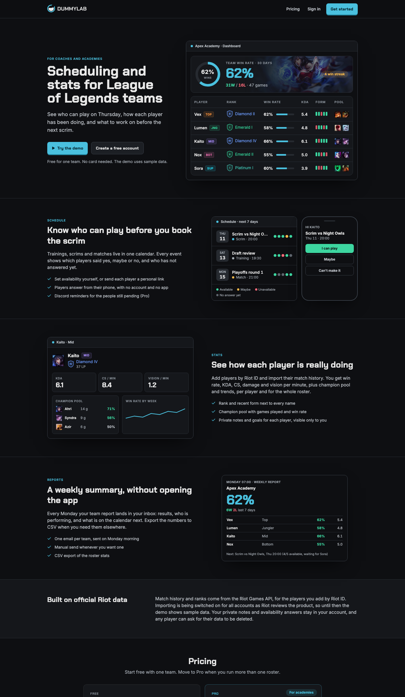
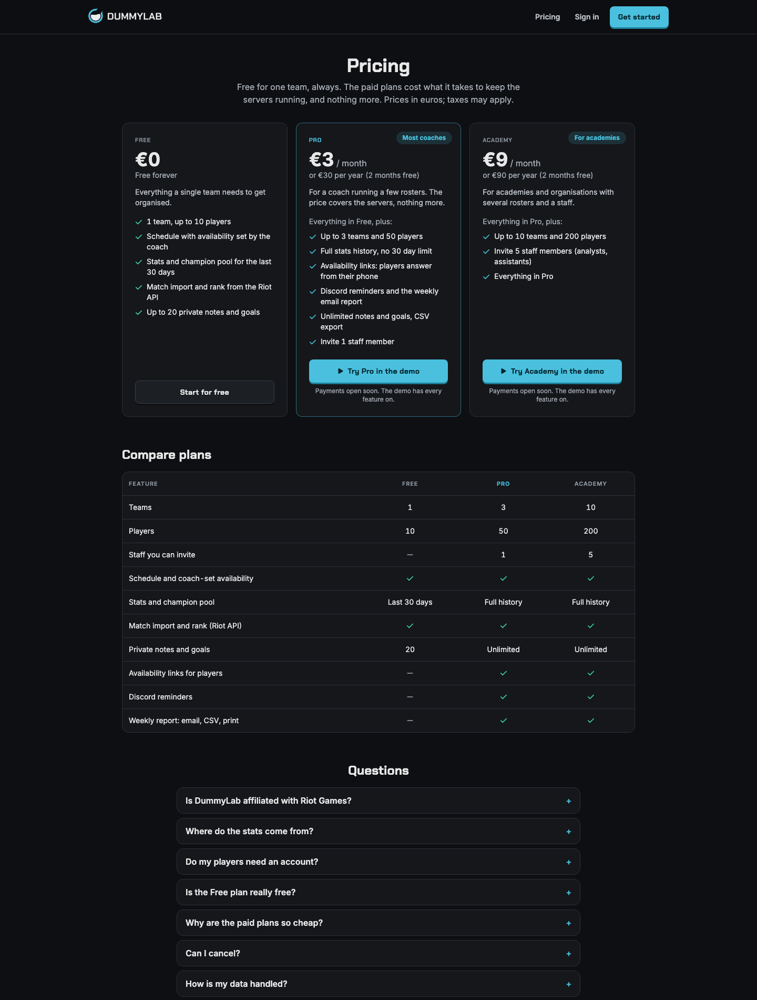
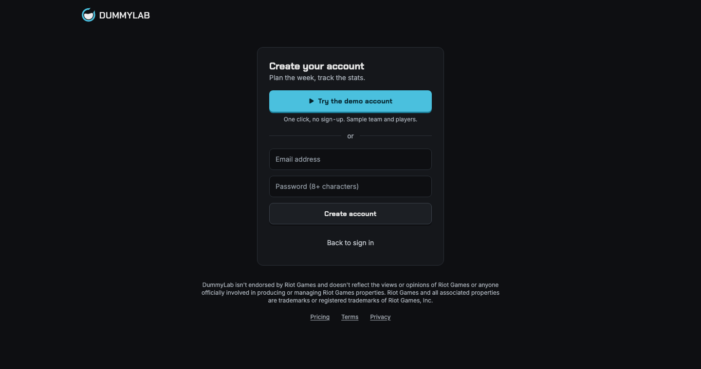

# DummyLab

A coaching dashboard for **League of Legends** teams. Plan trainings, scrims and matches with each player's availability, and follow per-player and per-team stats built from match history pulled from the Riot Games API.

**Live website: [dummylab.vercel.app](https://dummylab.vercel.app)**. Press "Try the demo" for a one-click login with a sample team (no sign-up).



| Pricing | Sign up |
|---|---|
|  |  |

The dashboard, schedule, players and analytics pages are behind the login: press "Try the demo" on the live site to see them.

## Features

- **Teams and players:** add players by Riot ID (verified against the Riot Account API) or by name, with role, rank and recent form.
- **Schedule:** month, week and agenda views for trainings, scrims and matches, weekly repeat, and a per-player availability matrix with a warning when fewer than five can play. Phones get a readable agenda.
- **Availability links (Pro):** each player gets a personal link to answer from their phone, with no account.
- **Analytics:** win rate, KDA, CS, damage and vision per minute, kill participation, champion pool and KDA trend, per player and per team, filtered by period and queue (solo, flex, clash, scrims).
- **Match history and ranked:** import recent games with timeline values at 10 and 20 minutes (Match-V5) and ranked entries (League-V4, by PUUID).
- **Private notes and goals** per player.
- **Staff access (Pro):** invite analysts and assistant coaches by email as *staff* (edit the schedule, keep their own notes) or *viewer* (read only). Players, billing and Riot settings stay with the owner.
- **Real sign-in:** email confirmation, password reset, a honeypot and optional Cloudflare Turnstile against spam, branded auth emails ([docs/AUTH_AND_EMAIL.md](docs/AUTH_AND_EMAIL.md)).
- **Discord reminders and a weekly report (Pro):** post an event's availability to a channel, and get a weekly summary by email, CSV or print.
- **Plans:** Free (1 team, 10 players, 30 days of stats), Pro at 3 EUR a month (3 teams, 50 players, 1 staff seat, full history, links, reminders, report) and Academy at 9 EUR (10 teams, 200 players, 5 staff seats). The paid prices only cover running costs. Limits are enforced in the database. Payments are built on Stripe test mode and switched off until launch.
- **Accessible and responsive:** keyboard-friendly dialogs, landmarks, 44 px touch targets, light on JavaScript.
- **Demo account:** one-click login that never exposes credentials to the browser. It has every Pro feature, cannot change email or be deleted, and is reset daily.

## Stack

Next.js 14 (App Router) · React 18 · Tailwind CSS · Zustand · Supabase (Auth, Postgres, Row Level Security) · Riot Games API · Stripe · Resend · Vitest and PGlite (Postgres in WASM, used to test the Row Level Security policies) · deployed on Vercel.

## How it's built

- The Riot API key stays on the server. Route handlers in `app/api` require a signed-in user, validate input, send the key in the `X-Riot-Token` header, time out after 8 seconds, retry short `429`s, explain outages and rejected keys in plain language, and rate-limit per user. Riot features are off by default and enabled per account or, once a production key exists, for everyone.
- Match import runs server-side in small batches (`/api/players/[id]/sync`); the client calls it until everything is imported.
- Sessions use `@supabase/ssr` cookies; `middleware.js` protects `/dashboard`. `GET /api/health` reports whether the app and database answer.
- The schema, Row Level Security, plan limits and stats functions live in `supabase/migrations`. Plan limits are database triggers, so they cannot be bypassed from the browser.
- Public surfaces are narrow on purpose: an availability link can only answer for one player and sees only titles and times; webhook URLs are only ever called if they are real Discord webhooks.
- State lives in small Zustand stores (`store/`); data access is in `hooks/`; pure logic (stats, availability, reports, plans) is in `lib/` and covered by tests.

## Running locally

1. Create a Supabase project and run the files in `supabase/migrations` in order (`0001` to `0009`) in the SQL editor, or with `supabase db push`.
2. Copy `.env.example` to `.env.local` and fill it in:

   | Variable | Where it comes from |
   |---|---|
   | `NEXT_PUBLIC_SUPABASE_URL`, `NEXT_PUBLIC_SUPABASE_ANON_KEY` | Supabase, Project Settings > API |
   | `SUPABASE_SERVICE_ROLE_KEY` | Same page. **Server only, never expose it.** |
   | `RIOT_API_KEY` | [developer.riotgames.com](https://developer.riotgames.com) (development keys expire every 24 hours) |
   | `RIOT_ENABLED`, `RIOT_ALLOWED_EMAILS` | Riot features are off unless enabled: allow-list your own email with a development key, set `RIOT_ENABLED=true` once a production key is approved ([docs/RIOT_REGISTRATION.md](docs/RIOT_REGISTRATION.md)) |
   | `DEMO_EMAIL`, `DEMO_PASSWORD` | Any credentials for the demo user |
   | `CRON_SECRET` | Any long random string (protects the daily demo reset and the weekly report) |
   | `BILLING_ENABLED`, `STRIPE_*` | Optional. Leave `BILLING_ENABLED=false` until launch ([docs/LAUNCH_CHECKLIST.md](docs/LAUNCH_CHECKLIST.md)) |
   | `RESEND_API_KEY`, `RESEND_FROM` | Optional. Enables the weekly report and staff invitation emails |
   | `NEXT_PUBLIC_TURNSTILE_SITE_KEY` | Optional. Cloudflare Turnstile on the sign-in forms ([docs/AUTH_AND_EMAIL.md](docs/AUTH_AND_EMAIL.md)) |
   | `NEXT_PUBLIC_ANALYTICS_SRC`, `NEXT_PUBLIC_ANALYTICS_ID` | Optional. Cookieless analytics (Umami) |

3. Install, test and run:

   ```bash
   npm install
   npm test
   npm run dev
   ```

4. Optional: create the demo account and sample data with `node --env-file=.env.local scripts/seed-demo.mjs`.

## Deployment

Deploy to Vercel with the same environment variables. `vercel.json` schedules a daily cron that resets the demo account and a weekly one that sends the reports. In Supabase, set the site URL and the `/auth/callback` redirect under Authentication > URL Configuration, and follow [docs/AUTH_AND_EMAIL.md](docs/AUTH_AND_EMAIL.md) for emails and spam protection.

## Riot Games

DummyLab isn't endorsed by Riot Games and doesn't reflect the views or opinions of Riot Games or anyone officially involved in producing or managing Riot Games properties. Riot Games and all associated properties are trademarks or registered trademarks of Riot Games, Inc.

## History

This is a rewrite of the first version ([dummylab](https://github.com/rmps23/dummylab), 2023), which also had champion pool tracking and a team schedule.
